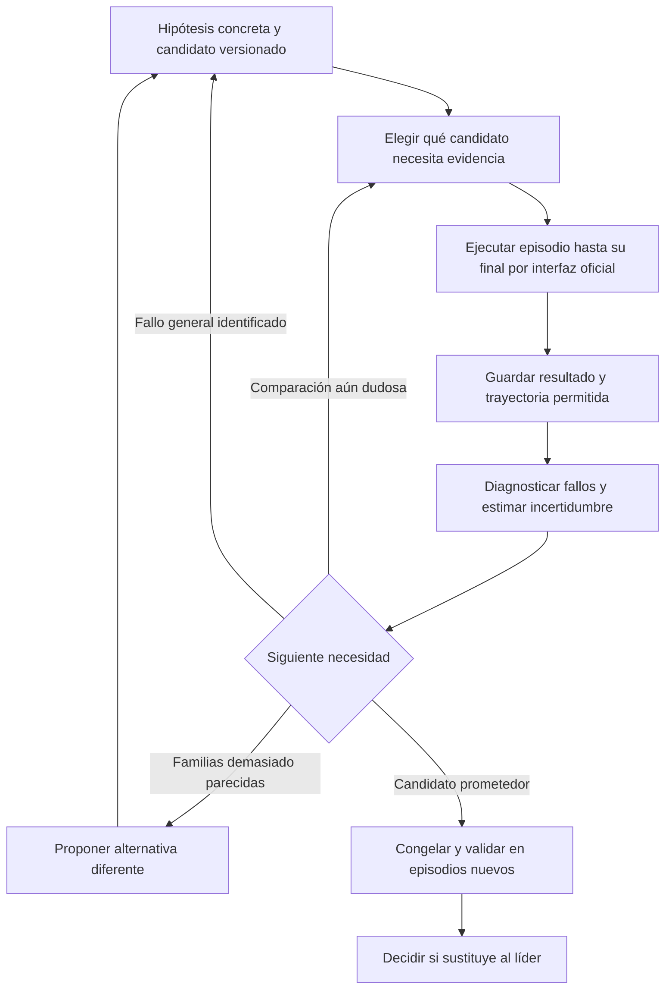

# Empezar de cero: cómo aprender del juego y mejorar estrategias

26 de octubre de 2026. La propuesta anterior de dos Skills está borrada. No estamos seleccionando todavía una arquitectura de Skills. El objetivo actual es producir evidencia útil mediante exploración y comparaciones controladas.

Mi recomendación es un **laboratorio adaptativo de políticas**: después de cada lote decidimos si conviene investigar un fallo, comparar dos estrategias casi empatadas o probar una familia nueva. No existe un método universalmente óptimo para un juego parcialmente observado cuya distribución de evaluación desconocemos. Sí podemos hacer mucho mejor que repetir partidas aleatorias indefinidamente.

La ampliación posterior está en [laboratorio jerárquico de políticas](hierarchical-lab/README.md). Precisa una distinción importante: MCTS **dentro de una partida** necesita generar continuaciones desde estados; MCTS **sobre versiones de políticas** puede evaluar cada candidata en partidas nuevas y no exige clonar estados. El segundo es el objeto de la nueva investigación.

## 1. Qué sabemos ahora

La [rama de Matteo](matteo-branch-review.md) declara 73.858 partidas aleatorias, supervivencia media de 5,91 meses y ninguna llegada a 48. No es un benchmark de razonamiento ni de Skills. Sus agregados no permiten recuperar qué acciones eran buenas.

He arrancado su interfaz y he jugado personalmente hasta el inicio del mes 7. La sesión sigue viva, conserva buenos indicadores de bienestar y recibió una evaluación C sin ascender. He visto continuaciones narrativas entre meses, acciones trimestrales y diferencias entre cambios descritos y variaciones visibles. Esto nos da preguntas; una sesión no identifica una política óptima.

El MCP oficial es accesible mediante el adaptador local. No aparece como herramienta nativa de este chat, pero el servidor local llama a las cinco herramientas oficiales por stdio. [Interfaz publicada](https://techarena-career-sim.readthedocs.io/en/latest/mcp.html). No he usado una clave de modelo ni ejecutado otro lote masivo.

## 2. Hay cuatro problemas matemáticos distintos

| Pregunta | Qué optimizamos | Método apropiado |
|---|---|---|
| ¿Qué está pasando en el juego? | Información sobre una hipótesis concreta | Diseño experimental; observar feedback, efectos diferidos y explicaciones alternativas. |
| ¿Qué nueva política merece probarse? | Mejora plausible y diversidad de candidatos | Evolución guiada por trazas, GEPA, búsqueda de políticas; optimización bayesiana si hay pocos parámetros bien definidos. |
| ¿A qué política damos la siguiente partida? | Reducir la probabilidad de elegir mal al final | Identificación de la mejor alternativa, asignación secuencial y comparación entre líder y contendiente. |
| ¿Funcionará fuera de nuestras pruebas? | Rendimiento bajo escenarios nuevos | Validación separada, análisis de fallos y robustez; volumen de dev por sí solo no basta. |

Confundir estas preguntas lleva a gastar muchas simulaciones sin resolver la decisión importante. Un experimento muy informativo sobre una mecánica puede aportar poco a la elección de la mejor política. Una política que ya sabemos que es mala no necesita miles de repeticiones para descartarla.

## 3. Representación del problema

Una política es una regla para elegir una acción a partir del historial observado: `a_t ~ πθ(a | h_t)`. El historial incluye el estado visible, el texto, las alternativas y el feedback legítimo de esa partida. No tenemos por qué conocer la fórmula interna que genera la transición.

En investigación, queremos estimar `μ(θ) = E[Q | πθ]`, la puntuación esperada de esa política. También registramos `P(llegar a 48)`, costes, errores de herramientas, evaluaciones y causas de salida. La métrica oficial de juego es la media de puntuación, no la supervivencia aislada. Los otros componentes oficiales y las restricciones de entrega siguen existiendo. [Evaluación](https://techarena-career-sim.readthedocs.io/en/latest/competition-rules.html).

Una política puede ser una instrucción breve en lenguaje natural. No hace falta decidir ahora si sus responsabilidades acabarán en uno, dos o más archivos. Los parámetros de un algoritmo de laboratorio tampoco deben presentarse como leyes internas del juego.

## 4. Dos bucles separados

El **bucle interno** juega una partida con una política fija pero reactiva al estado. El **externo** decide cómo cambiar esa política entre versiones y qué pruebas comprar. Cambiar instrucciones a mitad de una evaluación mezcla causas; una prueba de adaptación dentro de partida debe definirse como una política distinta, no improvisarse sin registrar.

“Episodio hasta su final” incluye una salida temprana real. No significa forzar que todos alcancen 48 meses ni cortar al mes 12 para ahorrar. Una sesión pausada, como mi exploración actual, es evidencia de interfaz y observación, no un resultado terminal.

## 5. En función de qué elegimos la siguiente prueba

### A. Incertidumbre que puede cambiar la decisión

Supongamos resultados ficticios:

| Política | Partidas | Media | Error estándar ilustrativo | Qué haría |
|---|---:|---:|---:|---|
| A | 30 | 60 | 0,5 | Referencia relativamente estable. |
| B | 10 | 62 | 4 | Repetir B y compararla con A: podría ser mejor o sólo más variable. |
| C | 30 | 45 | 1 | No seguir gastando en C salvo que investiguemos un fallo específico. |

La siguiente partida no va automáticamente al mayor promedio ni al candidato menos probado. Va donde puede reducir una **duda relevante**. Estas cifras son un ejemplo, no resultados del equipo.

Para un conjunto fijo de candidatos, la familia de métodos *best-arm identification* está pensada para elegir la mejor alternativa al final, a diferencia de los bandits que maximizan recompensa acumulada mientras aprenden. Top-two sampling centra esfuerzo en el líder y contendientes creíbles, con garantías bajo sus supuestos estadísticos, no en cualquier juego arbitrario. [Russo, método original](https://proceedings.mlr.press/v49/russo16.html).

Con pocos candidatos y poco presupuesto, una carrera sencilla por rondas es suficiente: probar todos, retirar los claramente inferiores, repetir los que siguen compitiendo. Al generar un candidato nuevo, su estadística empieza de cero. Si cambian las instrucciones o la versión del motor, no mezclar sus observaciones como si fueran la misma alternativa.

La intuición cuantitativa es que distinguir dos medias separadas por una diferencia `Δ` cuesta, aproximadamente y bajo supuestos regulares, del orden de `varianza / Δ²` muestras. Una diferencia de un punto puede exigir mucho más esfuerzo que una de diez. Esto justifica concentrar réplicas en candidatos próximos y ruidosos; no es una fórmula del juego ni una garantía de potencia con pocas partidas.

Si quisiéramos un descarte estadístico conservador para `K` políticas fijadas y puntuación acotada en `[0,100]`, una banda secuencial derivada de Hoeffding puede usar `ε_i(n) = 100 × sqrt(log(K × π² × n² / (3δ)) / (2n))`, recortando el intervalo al rango de puntuación. Una unión sobre políticas y tamaños de muestra controla el error total por `δ` bajo episodios independientes de distribución estable. Descartaríamos un candidato sólo si su cota superior queda por debajo de la cota inferior de otro. En muestras pequeñas estas bandas son muy anchas: su rigor no crea información. Un catálogo abierto de candidatos requiere repartir el presupuesto de error entre incorporaciones; un cambio de distribución invalida el supuesto. Es una opción analítica, no un algoritmo ya implementado.

### B. Fallos recurrentes con una intervención comprobable

No basta con “morimos por salud”. Hay que preguntar si el comportamiento ignoró señales, asumió trabajo adicional innecesario, gastó recuperación demasiado tarde o interpretó mal las opciones. Cada explicación produce una intervención distinta.

Registrar el periodo de riesgo y el comportamiento anterior es más útil que acumular un contador terminal. El 96,2% de salud/confianza del lote aleatorio no es un orden universal de prioridades: otros problemas quedan ocultos por las muertes tempranas. Analizar causas y duración conjuntamente evita ese error.

### C. Diversidad de comportamientos

Si todos los candidatos se comportan igual, cambiar adjetivos del prompt aporta poca exploración. Mantendría varias familias: cautela, crecimiento sostenible, respuesta fuerte al feedback, planificación trimestral y memoria compacta, inicialmente como **hipótesis independientes**, no Skills seleccionadas.

La idea de *quality-diversity* es conservar alternativas buenas que se comportan de forma diferente, en vez de permitir que un solo líder elimine prematuramente toda diversidad. En nuestro registro, los descriptores pueden ser frecuencia de recuperación, inversión en desarrollo, reacción a avisos y cambios de prioridad tras evaluaciones. Son métricas de comportamiento observadas, no supuestos umbrales internos. [MAP-Elites y poblaciones de políticas](https://arxiv.org/html/2303.12803v2).

### D. Beneficio por coste

Una comparación puede reducir mucha incertidumbre pero consumir todo el presupuesto. Estimar el valor esperado de cambiar correctamente de política por dólar o minuto es más útil que maximizar simplemente número de llamadas. No conocemos ese valor con exactitud: una aproximación transparente es preferible a fingir una fórmula óptima.

## 6. Primer diseño experimental desde cero

Antes de un lote, definir una referencia de razonamiento mínima y constante: mismo modelo, mismo entorno, mismas herramientas, sin la propuesta retirada. La ejecución representativa del agente usará JiuwenSwarm `0.2.4b3`, modo `agent`, y el modelo designado. El juego manual sigue siendo una categoría separada.

Una primera comparación interpretable es un **factorial 2 × 2**:

| Candidato | Atención explícita al deterioro de salud | Atención explícita al feedback de riesgos |
|---|---|---|
| P00 | Procedimiento general mínimo | Procedimiento general mínimo |
| P10 | Añadir seguimiento cualitativo de tendencia y carga | Como P00 |
| P01 | Como P00 | Añadir seguimiento cualitativo de avisos y consecuencias |
| P11 | Ambas intervenciones | Ambas intervenciones |

“Mínimo” no obliga a elegir opciones dañinas; sólo deja fuera el refuerzo específico. Mantener el resto del texto y el modelo constantes. Aleatorizar el orden de ejecución o alternar bloques para evitar confundir versión con cambios de disponibilidad o entorno. No hay semillas del simulador emparejadas documentadas.

El modelo analítico `Q = β0 + βH H + βR R + βHR H·R + ε` describe la comparación entre procedimientos: ayuda a preguntar si las dos intervenciones se complementan o interfieren. **No es una fórmula de puntuación del juego.** Los datos pueden no justificar estimarlo con precisión; reportar primero medias y resultados individuales.

Primera tanda: unas pocas partidas terminales por candidato para detectar errores grandes, después ampliar los contendientes según coste e incertidumbre. Tres por candidato son un piloto, no una comparación concluyente. Si el coste no permite cuatro candidatos, empezar por dos que respondan al fallo más claro. No lanzar un lote masivo sin que su escala y método estén aclarados.

Cuando mejore la continuidad, la siguiente pregunta puede ser progreso: comparemos inversión más temprana en resultados visibles frente a aprendizaje, o planificación del trimestre completo frente a elecciones aisladas. Cambiar una sola cosa en cada comparación sencilla; usar factoriales sólo cuando la interacción sea la pregunta.

## 7. Qué métodos modernos merecen atención

| Método | Aporta | Encaje real aquí |
|---|---|---|
| GEPA, aceptado en ICLR 2026 | Revisar trazas, proponer cambios de instrucciones y conservar una frontera de candidatos. | La mejor inspiración inmediata para cambiar procedimientos generales; sus mejoras en otros benchmarks no son una predicción para este juego. |
| EvoTest, ICLR 2026 | Evoluciona configuración entre episodios a partir del transcript. | Muy cercano al problema de aprender a jugar; su memoria de elecciones estado-acción no debe copiarse si acaba como respuestas fijas prohibidas. |
| Meta-TTL, 2026 | Aprende la propia regla que transforma experiencia en una nueva política. | Explica por qué hay que mejorar también el optimizador; necesitaría diversidad de tareas y más presupuesto para aplicarse en serio. |
| PACEvolve++, 2026 | Adapta la búsqueda por fases mediante un asesor entrenable. | Interesante investigación; entrenar un asesor y usar otro modelo ejecutor no equivale a una solución válida del track fijo. |
| Best-arm identification / top-two | Decide qué alternativa necesita la siguiente muestra. | Muy útil para gastar partidas en comparaciones relevantes. No requiere adoptar una arquitectura multiagente en el juego. |
| BO / TuRBO | Explora políticas parametrizadas con evaluaciones caras y ruido. | Útil si definimos pocos parámetros de diseño interpretables; no aplicar un GP a prompts arbitrarios y asumir suavidad. |
| Quality-diversity / MAP-Elites | Conserva familias distintas para evitar converger demasiado pronto. | Un archivo pequeño de candidatos diversos puede bastar; no es necesario implementar una gran librería. |
| DreamerV3 / modelos del mundo | Aprende dinámicas y planifica en escenarios imaginados. | Con recursos enormes podría ser una línea de investigación. Necesita buena representación, control de error y aclaración sobre uso de modelos aprendidos. |
| POMCP / MCTS | Busca continuaciones desde un estado de creencias. | Requiere un simulador generativo de ramas; el MCP vivo no documenta clonación, undo ni inicialización arbitraria. |
| Diseño bayesiano de experimentos | Selecciona pruebas informativas sobre una hipótesis. | Útil para estudiar mecanismos, pero no equivale a seleccionar la mejor política ni autoriza reconstruir reglas ocultas para la entrega. |

Fuentes primarias: [GEPA](https://arxiv.org/abs/2507.19457), [EvoTest](https://proceedings.iclr.cc/paper_files/paper/2026/file/aa5b64942bfef625403b355214b871e0-Paper-Conference.pdf), [Meta-TTL](https://arxiv.org/html/2604.00830v2), [PACEvolve++](https://arxiv.org/html/2605.07039), [TuRBO](https://arxiv.org/html/1910.01739v4), [DreamerV3](https://www.nature.com/articles/s41586-025-08744-2), [POMCP](https://proceedings.neurips.cc/paper/2010/hash/edfbe1afcf9246bb0d40eb4d8027d90f-Abstract.html), [diseño experimental](https://proceedings.mlr.press/v108/foster20a.html).

La parte aplicable de estos trabajos es el principio experimental, no sus herramientas concretas ni todos sus permisos. “Más moderno” no significa “más adecuado”: un comparador secuencial sencillo puede aportar más esta semana que entrenar un modelo del mundo.

## 8. Si tuviéramos infinitas simulaciones

### Lo que sí resolveríamos bajo supuestos claros

Para un conjunto finito de políticas, en una distribución fija, con episodios independientes y suficientes muestras para cada candidata, podríamos estimar cada media con precisión arbitraria. Si la mejor es única, llegaríamos a distinguirla. Los procedimientos adaptativos organizan el orden de las muestras para llegar antes a una buena decisión.

Podríamos ampliar el catálogo, conservar distintas familias y repetir ciclos de generación, evaluación y selección. También estudiaríamos casos raros y distintas etapas de la carrera, sin limitarnos al principio.

### Lo que el infinito no arregla

1. Simular siempre la política aleatoria sólo estima cada vez mejor la política aleatoria.
2. Si exploramos sólo una pequeña familia, no descubrimos automáticamente una política fuera de ella.
3. Infinitos episodios del mismo dev no revelan cómo cambia el test oculto.
4. Muchos resultados agregados no sustituyen trayectorias informativas.
5. No observar el estado oculto puede impedir identificar una fórmula única, incluso con muchos datos.
6. Saber una dinámica no garantiza que su conocimiento se pueda usar en una entrega bajo las reglas actuales.

Por tanto, ampliaría **qué probamos**, **dónde conseguimos llegar** y **qué evidencia guardamos**; no mantendría un contador infinito de partidas iguales. Crear nuevos estados mediante decisiones legítimas difiere de editar una base de datos o modificar el entorno, prácticas que no estamos proponiendo.

## 9. Qué guardar desde la siguiente partida

Tres niveles de datos, fuera de los paquetes internos:

- **Por episodio:** versión exacta de política/entorno, método manual o modelo, final o pausa, meses, puntuación, razón de salida, coste y uso de herramientas.
- **Por transición:** observación oficial anterior, alternativas ofrecidas, elección y justificación breve, observación posterior, eventos o avisos nuevos y momento real del cambio de mes/evaluación.
- **Por experimento:** pregunta, comparación, métrica primaria, presupuesto, criterio de continuación y decisión final.

Conservar originales y añadir análisis separado. No cambiar artifacts para “limpiar” la puntuación. No subir claves, bases de datos ni paquetes. Los detalles de mi exploración manual están en una carpeta local ignorada; los informes sólo resumen aprendizajes generales.

No usar el registro de partidas como una tabla de respuestas por título de evento. La inferencia retrospectiva fuera de política tampoco se arregla con volumen: en trayectorias largas los pesos de importancia pueden ser muy variables, y sin acciones/propensiones registradas ni siquiera podemos calcularlos. Los agregados actuales de Matteo no permiten esa evaluación.

## 10. Cómo decidir que avanzamos

Una versión avanza si su mejora se sostiene en episodios nuevos y su coste/fiabilidad son aceptables. No basta con su mejor partida. Evaluar media de puntuación, proporción que llega a 48, distribución y fallos. Las métricas de cola, como el promedio del peor 10% cuando haya muestras suficientes, ayudan a detectar fragilidad; no reemplazan la media oficial.

Congelar la candidata antes del lote de confirmación. Si miramos el resultado y cambiamos instrucciones, el siguiente lote vuelve a ser desarrollo. Para un muestreo adaptativo serio, los intervalos ordinarios calculados después de mirar repetidamente pueden resultar optimistas; usar un protocolo de confirmación separado o métodos secuenciales apropiados, sin vender un piloto como significación estadística.

El avance debe verse en un registro: pregunta → resultado → cambio → nueva comparación. Cuando se estanque la media, preguntar si falta diversidad, si las versiones están sobreajustadas al dev o si el cuello de botella es ejecutar mal el procedimiento.

## 11. Próximos pasos concretos

1. Continuar unas pocas sesiones manuales con preguntas explícitas: cuándo llegan los avisos, qué información es accionable, qué compromisos persisten y qué distingue recuperación de progreso. No hace falta millones para entender la interfaz.
2. Registrar un procedimiento mínimo desde cero y fijar el entorno/modelo oficial antes de medir agentes.
3. Ejecutar una comparación pequeña de dos a cuatro políticas generales. Guardar episodios terminales y trayectorias útiles.
4. Dedicar nuevas partidas a los contendientes y dudas que pueden cambiar la selección, no a repetir candidatos claramente peores.
5. Mejorar la generación de candidatos con las trazas y conservar diversidad. Sólo después convertir procedimientos respaldados por evidencia en Skills.

Las reglas siguen exigiendo aclaración para métodos no contemplados y prohíben incluir fórmulas ocultas o respuestas memorizadas. La autorización del usuario para explorar permite el juego manual actual; no demuestra permiso del organizador para automatización ilimitada. [Reglas vinculantes](https://techarena-career-sim.readthedocs.io/en/latest/competition-rules.html).
