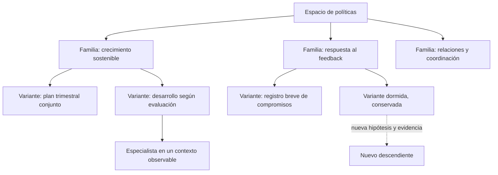

# Diseño del árbol de políticas y su orquestador

Este documento propone un procedimiento de investigación. Las cifras de configuración son hipótesis de trabajo, no resultados ni leyes del juego. La [bibliografía](bibliography.md) distingue fuentes y límites; el [apéndice matemático](mathematics.md) detalla qué partes tienen garantías bajo supuestos y cuáles son heurísticas propias.

## 1. Dos árboles diferentes

En un árbol de jugadas, un nodo es un estado del simulador y una arista es una acción. Explorar hermanos suele requerir restaurar el mismo estado. El MCP publicado no ofrece esa operación.

En nuestro árbol, un nodo es una política completa: instrucciones versionadas, memoria permitida dentro de partida, modos de decisión y configuración del actor. Una arista es un cambio de diseño. Probar hermanos significa jugar episodios nuevos con esas políticas. Por tanto, **sí podemos investigar MCTS sobre políticas sin clonar el juego**. Esto precisa la limitación sobre MCTS dentro de partida expuesta en la investigación anterior.

MCTS-AHD es el precedente más directo: organiza heurísticas generadas en un árbol y permite seguir desarrollando candidatas temporalmente inferiores. AB-MCTS añade una acción explícita de generar un hijo para elegir entre abrir una alternativa y refinar una existente. Ambos trabajan sobre soluciones generadas, no prueban una estrategia óptima para esta competición. [MCTS-AHD](https://proceedings.mlr.press/v267/zheng25o.html), [AB-MCTS](https://arxiv.org/abs/2503.04412).

Las etiquetas son ejemplos generales de investigación; no son Skills implementadas. La raíz puede tener varias familias sin imponer un único punto de partida ni recuperar las dos Skills retiradas.

## 2. Qué representa un nodo

Separaría **familia**, **política** y **evaluación**:

- Una familia agrupa una idea y un espacio de posibles revisiones.
- Una política es un artefacto inmutable que puede jugar un episodio. Cambiar una instrucción crea otra versión.
- Una evaluación aplica una política con un actor y un entorno concretos. Produce un resultado y una trayectoria.

Cada política guarda sus padres, el cambio respecto a ellos, la hipótesis que lo motivó, sus condiciones públicas de uso, límites de memoria y vínculos a evidencia. No basta con “rama ambiciosa, nota 70”.

Si recombinamos dos candidatas, el linaje se convierte en un **grafo con varios padres**, aunque mantengamos una vista de árbol para navegar. Una política idéntica debe reconocerse por hash y no contarse dos veces como descubrimiento independiente. Una nueva evaluación sí es una nueva muestra cuando cumple sus supuestos.

No crearía una rama Git por cada partida. Guardaría los nodos como registros y reservaría ramas Git para trabajo humano o implementaciones independientes. El historial de políticas necesita identificadores y referencias, no miles de fusiones.

## 3. Responsabilidades de Opus, del planificador y del trabajador

**Opus como investigador** lee resúmenes de familias, incertidumbres y una muestra de trazas relevantes; propone hipótesis, mutaciones o especializaciones y explica qué observación podría refutarlas. Puede inspirarse en varias ramas. No recibe una masa indiscriminada de logs en cada turno.

**Un planificador verificable** decide qué trabajo puede lanzarse, controla presupuestos, congela el artefacto y conserva el registro. Las reglas sobre gasto, concurrencia, repeticiones y estado de las tareas no deberían depender de que el LLM recuerde cumplirlas.

**Un trabajador** recibe una política congelada y juega una sesión independiente mediante herramientas oficiales. Reacciona al estado como dicta esa política, pero no la reescribe mientras está siendo medida. Devuelve resultados estructurados y referencias a la trayectoria. Si el orquestador cambia sus instrucciones durante el episodio, hemos definido una política interactiva diferente y hay que etiquetarla como tal.

La arquitectura de Anthropic respalda la utilidad de contextos independientes y tareas bien delimitadas; también documenta el mayor consumo de tokens y dificultades cuando los subtrabajos dependen mucho unos de otros. Las partidas independientes ofrecen una separación natural, pero su ventaja económica aún debe medirse. [Informe de ingeniería](https://www.anthropic.com/engineering/multi-agent-research-system).

## 4. Acciones disponibles para el orquestador

| Acción | Para qué sirve | Evidencia que debe dejar |
|---|---|---|
| Generar familia | Explorar una actitud sustantivamente distinta | Hipótesis y diferencia de comportamiento prevista. |
| Refinar política | Corregir un fallo general o mejorar una prioridad | Cambio acotado y resultado que esperamos observar. |
| Repetir evaluación | Reducir incertidumbre sobre una candidata fija | Nueva muestra, sin cambiar el artefacto. |
| Especializar | Probar una regla general de cambio de modo | Contexto observable, modos alternativos y coste de complejidad. |
| Recomponer | Combinar procedimientos compatibles | Padres, conflictos resueltos y prueba de integración. |
| Reabrir archivo | Comprobar ruido, nueva evidencia o potencial | Motivo explícito; puede producir una réplica o un descendiente. |
| Promover a modelo objetivo | Comprobar transferencia de una candidata | Episodio con el modelo/configuración oficial, identificado aparte. |
| Congelar para confirmación | Elegir sin seguir ajustando al mismo lote | Política y protocolo cerrados antes de ver resultados. |

Repetir y refinar son trabajos distintos. Generar otros diez hijos no reduce la incertidumbre sobre el padre, y repetir el padre no demuestra que ya conocemos la calidad de sus hijos aún no inventados.

## 5. Cómo empezar con actitudes generales

Formaría un conjunto pequeño de familias lo bastante distintas para detectar diversidad real: equilibrio reactivo, crecimiento sostenible, desarrollo de capacidad, coordinación/relaciones, control de compromisos y planificación trimestral. Ninguna declara respuestas por evento ni supuestos umbrales secretos.

Opus redactaría una diferencia procedimental por candidata y un resumen operativo que el actor barato pueda seguir. Antes de simular, revisaríamos si dos políticas producen prácticamente las mismas prioridades, si hay contradicciones y si el texto excede la capacidad del trabajador.

No pondría una competición entre “persona simpática” y “persona ambiciosa” sin definir comportamiento. Esas etiquetas son ambiguas y cada modelo puede interpretarlas de una manera. Una hipótesis comprobable sería: “hacer explícitos los compromisos pendientes antes de aceptar más carga reduce salidas prematuras sin bloquear el progreso”.

## 6. Anchura y profundidad

La expansión debe tener un coste y una razón. Una regla inicial de **ensanchamiento progresivo** limita el número de hijos según el esfuerzo invertido en la familia, por ejemplo `hijos_permitidos = max(2, floor(k × (1 + visitas)^α))`, con `0 < α < 1`. El coeficiente y el exponente serían parámetros del laboratorio, no reglas del juego. La raíz puede tener una fase inicial de familias predefinidas.

Eso evita gastar todo el presupuesto generando políticas sin repetir ninguna. Tampoco obliga a profundizar siempre en la actual mejor: se mantiene una acción de nueva generación y un archivo independiente.

La opción más avanzada es aprender o modelar la decisión entre generar y refinar, como AB-MCTS. Empezaría con un control sencillo y registraría sus decisiones para compararlo con esa alternativa; no trasladaría una ecuación UCT sin comprobar qué recompensa, brazos y distribución está suponiendo.

## 7. Dos valores por nodo, nunca uno solo

**Rendimiento al jugar:** media, distribución e incertidumbre de episodios de una política exacta, con un actor exacto.

**Potencial de desarrollo:** utilidad esperada de invertir investigación en esa familia: novedades plausibles, descendientes prometedores, fallos corregibles y productividad reciente.

Una familia puede tener una política inicial mediocre y un gran potencial. A la inversa, una excelente política puede estar estancada como punto de partida para mutaciones. Las cotas de confianza del primer valor no son cotas del segundo. Los métodos HOO/StoSOO/BAST ofrecen teoría bajo estructura y regularidad; no han demostrado que la similitud de prompts permita acotar todos sus descendientes. [HOO](https://www.jmlr.org/papers/v12/bubeck11a.html), [StoSOO](https://proceedings.mlr.press/v28/valko13.html), [BAST](https://arxiv.org/abs/cs/0703062).

## 8. Qué se puede descartar

Eliminaría del conjunto ejecutable una política inválida, una duplicación exacta o un artefacto que viola requisitos. Conservaría el registro y el motivo. Un cambio que la corrige produce otro identificador.

Una política válida con evidencia desfavorable puede pasar a **dormancia**. Sus instrucciones, métricas y linaje permanecen. Si retiramos temporalmente una familia del presupuesto, no afirmamos que todos sus descendientes son inferiores.

Los motivos de reapertura son distintos:

| Situación | Prueba adecuada |
|---|---|
| Pocas partidas y resultados ruidosos | Réplicas de la misma política. |
| Puntuación temprana baja pero posible beneficio tardío | Episodios completos; no cortar por rendimiento parcial. |
| Ancestro débil con nueva idea prometedora | Generar un descendiente distinto y evaluarlo. |
| Procedimiento útil sólo en cierto contexto | Insertarlo como modo de una política completa y comparar. |
| Ranking dudoso entre modelos | Evaluación directa en el modelo objetivo. |
| Cambio de versión del modelo o del entorno | Nuevo periodo experimental; no mezclar medias sin justificarlo. |

## 9. Cómo reabrir sin que todo sea azar

Mantendría una cola de archivo que combine antigüedad desde la última revisión, incertidumbre, diversidad de comportamiento y una hipótesis nueva. Reservar una pequeña cuota de pruebas para el archivo es un punto de partida, no una constante óptima. Puede compararse una cuota nula con, por ejemplo, cuotas del 5% y 10% del presupuesto de investigación.

El archivo no debe depender sólo de máxima puntuación: puede conservar una candidata que logra llegar a etapas poco observadas o que mantiene una relación distinta entre progreso y estabilidad. El objetivo oficial sigue siendo el rendimiento; el archivo facilita encontrarlo.

MAP-Elites formaliza la conservación de buenos ejemplares por nicho; Go-Explore y POET muestran el valor de escalones intermedios en otros entornos. Adoptamos el principio de no perder alternativas útiles, sin importar sus capacidades de restaurar estados o inventar entornos. [MAP-Elites](https://arxiv.org/abs/1504.04909), [Go-Explore](https://arxiv.org/abs/2004.12919), [POET](https://arxiv.org/abs/1901.01753).

## 10. Especialización: el ejemplo del mes 8

“Desde el mes 8 cambia la estrategia” es una hipótesis que puede confundir varias causas. Quizá cambia el nivel, aparece feedback nuevo, se agotan recursos o sólo los mejores supervivientes llegan allí. El mes es visible, pero no demuestra que sea el mecanismo.

Compararía tres políticas completas: la política general, una revisión que usa el calendario como preferencia de diseño y otra que cambia de modo por contexto observable. Si una regla temporal no supera una explicación por estado en episodios nuevos, no la conservaría por haber encajado en las trazas antiguas.

Una especialización necesita condición de entrada, comportamiento, condición de salida y prioridad si compite con otro modo. Ese es el lenguaje de las **opciones** de aprendizaje jerárquico. Los modos pueden ser recuperación, entrega, desarrollo o gestión de compromisos; sus activaciones deben apoyarse en información legítima y generalizable. [Marco original de opciones](https://all.cs.umass.edu/pubs/1999/sutton_ps_AI99.pdf).

Las instrucciones específicas sobre un evento nombrado o una situación narrativa memorizada no son una especialización válida para la entrega. Tampoco debemos presentar el mes seleccionado o un valor aprendido como un umbral interno revelado.

## 11. No comparar supervivientes como si fueran intercambiables

Una política A puede llevar al mes 8 a empleados frágiles y otra B a empleados con mucha capacidad acumulada. Comparar sólo sus acciones desde ese mes mezcla el efecto del procedimiento con el estado que cada prefijo produjo.

La comparación principal será siempre entre políticas completas desde una partida nueva. Para estudiar una continuación, diseñaremos prefijos comparables y una asignación aleatoria de continuaciones, cuando el protocolo lo permita, en vez de reclamar contrafactuales a partir de partidas diferentes. Las reglas y configuración oficiales deben permitir cualquier mecanismo utilizado.

No hay un atajo estadístico que permita clonar un historial oculto con sólo observar su panel. La puntuación inmediata de una acción tampoco recoge necesariamente compromisos, riesgo acumulado y efectos posteriores.

## 12. Haiku no mide automáticamente lo que hará el modelo oficial

Una política compleja puede fallar con Haiku por ejecución, no por mala estrategia; otra puede funcionar especialmente bien con su sesgo. El modelo de trabajo produce una función `μ_modelo(política)`, no una versión con más ruido de una media universal.

Empezaría con una **matriz de calibración**: varias políticas de familias distintas, episodios completos por actor y medición del acuerdo de ranking, recuperación de candidatas fuertes y fallos de seguimiento. La correlación es un diagnóstico con incertidumbre, no un certificado; las nuevas familias pueden tener una fidelidad distinta.

Las mejores candidatas baratas deben pasar al actor objetivo. También una muestra de candidatas descartadas debe comprobarse directamente, para detectar falsos descartes. Si la relación es mala, Haiku puede seguir siendo útil para tareas acotadas de análisis, pero dejaría de usarse para podar por puntuación.

La literatura ofrece ejemplos tanto de transferencia útil entre modelos como de necesidad de adaptar prompts. La respuesta para esta competición es empírica. [S2LPP](https://arxiv.org/abs/2505.20097), [MAPO](https://arxiv.org/abs/2407.04118), [fidelidad dependiente del candidato](https://proceedings.mlr.press/v244/fan24a.html).

## 13. Cuándo subir a Sonnet

Separaría dos escaladas: una candidata que necesita mejor ejecución y un análisis de fallo que necesita mejor razonamiento. Para la primera, fijaría un nuevo brazo experimental con Sonnet y mediría toda la política. Para la segunda, Opus/Sonnet pueden proponer una revisión que después se prueba de forma controlada.

No cambiaría de modelo en mitad de las partidas y mezclaría luego sus resultados con las de Haiku. Un actor híbrido de escalada por decisión es una política distinta que requiere evaluación propia y no equivale al runtime oficial. El precio del modelo, el seguimiento de instrucciones y el orden de estrategias deben medirse por separado.

## 14. Qué tomar de los sistemas más fuertes

ShinkaEvolve aporta ideas útiles de archivos, inspiración entre islas y rechazo de propuestas redundantes; sus ablaciones favorecen conservar diversidad frente a ascender siempre al líder. AdaEvolve añade adaptación del esfuerzo según productividad y creación de direcciones cuando hay estancamiento. La contribución que proponemos es adaptar esos controles a **episodios estocásticos y actores con sesgo**, sin usar el máximo de una partida como verdad. [ShinkaEvolve](https://arxiv.org/abs/2509.19349), [AdaEvolve](https://arxiv.org/abs/2602.20133).

GEPA/ReEvo motivan revisiones que responden al feedback; EvoTest y Meta-TTL muestran que mejorar el proceso de adaptación también importa. Sus mecanismos de memoria o entrenamiento no se importan íntegramente al track. [GEPA](https://arxiv.org/abs/2507.19457), [ReEvo](https://arxiv.org/abs/2402.01145), [EvoTest](https://arxiv.org/abs/2510.13220), [Meta-TTL](https://arxiv.org/abs/2604.00830).

Los trabajos de 2026 sobre árboles con memoria, como TreeFlex y TreeSeeker, refuerzan la utilidad de guardar evidencia por rama y restaurar sólo el contexto relevante. En el laboratorio podemos restaurar **contexto de investigación**, no asumir restauración del estado del juego. TreeFlex, además, entrena la navegación del árbol y su ejecución descrita es secuencial: no es una demostración de que una flota masiva de workers resulte mejor aquí. [TreeFlex](https://arxiv.org/abs/2610.20334), [TreeSeeker](https://arxiv.org/abs/2606.11662).

## 15. Qué enseñan ganadores reales

El informe del equipo Unagi sobre ICFP 2025 describe una aplicación precisa: optimizar una parte medible de su solución humana con 320 pruebas de ShinkaEvolve y unos 60 USD. El resultado ayudó al equipo ganador; no fue una victoria automática sin intervención humana. El aprendizaje transferible es elegir un cuello de botella comprobable y reutilizar los hallazgos, no lanzar trabajadores sin una pregunta. [Relato del autor](https://sakana.ai/icfp-2025/).

El caso AHC058 combina construcción diversa y modificaciones estructurales grandes, además de una evaluación conocida. Su presupuesto y condiciones son distintos. Refuerza que una mutación que cambia el enfoque puede valer más que muchas variaciones mínimas. [Caso ALE-Agent](https://sakana.ai/ahc058/).

## 16. Si el presupuesto fuera ilimitado

Con una lista finita de políticas y un entorno estable, muchas réplicas pueden determinar sus medias con creciente precisión. Con una regla que garantice revisitas, no dependemos de una primera mala muestra.

Pero el espacio abierto de políticas no se agota por lanzar workers. Necesitamos operadores capaces de proponer cambios útiles, una representación que no excluya las soluciones buenas y diversidad suficiente. Tampoco las réplicas del dev identifican la distribución oculta de evaluación.

Por eso el sistema debe aprender en dos niveles: cómo jugar mejor y cómo elegir mejores experimentos. El criterio de avance será rendimiento confirmado por presupuesto, con evidencia de qué mecanismo ayudó. El tamaño del árbol es una métrica de trabajo, no de éxito.
