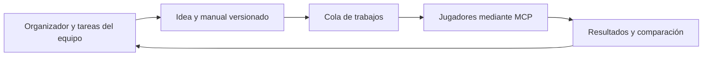

# Cómo ha organizado Claude el proyecto

Revisión informativa solicitada por Alejandro el 26 de octubre de 2026. Rama: `alejandro/explicacion-repo`. Base: `origin/main` en `f3342ed`; [ESTADO.md](../../ESTADO.md) actualizado a las 16:20 UTC e [informe de la nube](../../lab/reports/cloud-run-status.md) generado a las 16:19 UTC. Es una explicación de esa fotografía guardada, no una comprobación en directo de los procesos cloud ni una auditoría completa del código.

## La idea central

Estamos buscando el mejor **manual de instrucciones en inglés** para el agente que jugará la competición: DeepSeek dentro de JiuwenSwarm. El juego dura hasta 48 meses y evalúa la carrera conseguida, con posibles eliminaciones antes del final.

Claude ha construido **CareerLab**, un laboratorio para proponer manuales, probarlos en partidas, conservar lo observado y decidir qué merece más experimentos. Aquí una *policy* es una versión concreta del manual; el *actor* es el modelo y su configuración que lo ejecutan. Cambiar un manual y cambiar de modelo son experimentos diferentes.

La entrega final necesita las Skills, los documentos de diseño y un vídeo. La infraestructura de investigación ayuda a elegir y justificar esa entrega; su avance técnico por sí solo no demuestra que la estrategia vaya a ganar.

## Qué significa que haya creado tareas

Hay tres niveles que conviene distinguir:

| Nivel | Qué representa | Ejemplo del repo |
|---|---|---|
| Tareas del equipo, T1–T13 | Un objetivo con responsable, estado y lugar donde dejar el resultado. Puede ocupar una sesión completa. | T3: diseñar una estrategia que busque ascensos y dinero cuando esté a salvo. |
| Subagentes de desarrollo o análisis | Ayudantes temporales que investigan, programan, escriben manuales o revisan el trabajo de otro agente. | Auditores con verificadores adversariales; un diseñador de ideas externas que no ve nuestros manuales. |
| Trabajos de partidas, llamados *jobs* | Una repetición concreta con una versión congelada del manual, un actor y un entorno registrados. | Probar F8 cuatro veces con la misma configuración de Haiku. |

La **rama de Git** permite trabajar sin pisar a los demás. No corresponde a una partida: una tarea en una rama puede producir código, un informe, varios manuales y muchas partidas.

El [diario](../../progress.md) deja constancia de grupos de subagentes para auditar, construir, revisar ideas y generar variantes. Eso explica la aparición de muchas tareas: unas construyen el laboratorio y otras lo utilizan para aprender sobre el juego.

## Quién coordina y qué está automatizado

Según ESTADO.md, la organizadora es la sesión cloud **“CareerLab continuous race in the cloud”**, en `cloud-lab-run`. Decide el siguiente experimento, integra ramas terminadas en `main` y actualiza el estado común. El organizador local anterior se ha retirado de ese papel.

Los programas de Python reparten los trabajos entre jugadores, guardan resultados, controlan cuota, gestionan interrupciones y calculan comparaciones. Los [scripts cloud](../../scripts/cloud-run/README.md) ejecutan tandas de la cola y registran decisiones al acabar. La sesión de Claude interpreta esos resultados y propone las nuevas versiones; el `driver.py` por sí solo no redacta nuevos manuales.

Cada jugador de una partida recibe su manual congelado y usa el MCP oficial. Las partidas se ejecutan mediante código, sin recorrer la interfaz del navegador. Las llamadas al juego siguen teniendo latencia y los jugadores LLM consumen cuota: automatizar el proceso no equivale a tener millones de partidas gratuitas.

## Un ejemplo concreto: T3 y F8

1. El análisis encontró que, entre las carreras completadas, faltaban sobre todo puntos de nivel profesional y dinero.
2. T3 convirtió ese diagnóstico en una pregunta: ¿podemos conservar la protección de F3 y buscar crecimiento cuando no hay señales de peligro?
3. Se escribió [F8 secure growth](../../lab/policies-src/f8-secure-growth/f8-secure-growth-v1/policy.json), con padres, hipótesis, comportamiento esperado y condiciones que refutarían la idea.
4. Su texto se comprueba, se registra como una versión identificable y se encolan repeticiones con Haiku.
5. Se comparan puntuación, supervivencia y comportamiento observado. En la fotografía revisada había cuatro resultados, con una eliminación: todavía es una hipótesis en evaluación.
6. El siguiente paso puede ser repetir, crear una hija más prudente o dejarla dormida. Cada modificación produce una nueva versión y conserva la anterior.

Una familia puede tener varias hijas y combinar ideas de distintos padres. Por eso el historial de manuales es una genealogía de experimentos, no necesariamente un árbol sencillo.

## Dónde está cada cosa

| Archivo o carpeta | Para qué sirve |
|---|---|
| [ESTADO.md](../../ESTADO.md) | Entrada principal: contexto, tareas, responsables, fechas, decisiones y reglas de colaboración. `AGENTS.md` y `CLAUDE.md` remiten aquí. |
| [task_plan.md](../../task_plan.md), [findings.md](../../findings.md), [progress.md](../../progress.md) | Plan técnico del organizador, hallazgos y diario. Permiten retomar una sesión sin depender de su chat. |
| [research/careerlab/](.) | Justificación del método, revisión crítica de las ideas previas, presupuesto del modelo final y preparación de la historia para el jurado. |
| [careerlab/](../../careerlab/) y [tests/](../../tests/) | El programa que conecta con el juego, ejecuta trabajos, registra, compara y empaqueta; las pruebas de ese programa. |
| [lab/policies-src/](../../lab/policies-src/) | Familias y versiones de los manuales, con su hipótesis y sus Skills en inglés. |
| [lab/protocol/](../../lab/protocol/) | Reglas estadísticas fijadas de antemano. Si se cambian, corresponde una versión nueva. |
| [lab/registry/](../../lab/registry/) y [lab/reports/](../../lab/reports/) | Exportaciones de los experimentos y los informes que los interpretan. Se puede rastrear qué manual jugó cada actor. |
| [lab/README.md](../../lab/README.md) y [scripts/cloud-run/](../../scripts/cloud-run/) | Instrucciones de uso y programas para mantener las tandas en la nube. |

Los datos de ejecución voluminosos viven fuera del repo, en el directorio configurado por `CAREERLAB_DATA`. El repo conserva código, manuales, metadatos exportados e informes necesarios para compartir el trabajo.

T11, de Leah, ya está integrada: permite distinguir los resultados de varias máquinas por su origen. La nube escribe el registro común; las otras máquinas exportan a su carpeta de origen y la organizadora importa esos datos.

## Cómo intenta evitar pruebas engañosas

El [método elegido](method-decision.md) es una carrera de candidatos: repartir pruebas entre distintas ideas, dedicar más evidencia a las prometedoras y conservar opciones de volver a las descartadas.

- **Capacidad del jugador:** mantiene separados los resultados por configuración del modelo. Un manual que funciona con Opus puede fallar con Haiku; aún falta comprobar el traslado a DeepSeek.
- **Beneficios tardíos:** compara episodios completos, incluida una eliminación legítima. Interrumpir una ejecución por un fallo técnico no cuenta como perder. Además evita decidir sólo con las partidas que acaban antes.
- **Reglas que parecen funcionar por casualidad:** pide hipótesis y refutación, conserva versiones y contempla controles antes de convertir una observación en una regla del manual final.

Las reglas contemplan al menos cuatro repeticiones antes de declarar dormido un candidato y una probabilidad suficientemente baja de acercarse al líder. **Cuatro es un mínimo operativo, no una garantía de conocer su puntuación real.** Hay incertidumbre, comparaciones de robustez y reaperturas. La generación de nuevas ideas y las respuestas al estancamiento evitan limitarse a retocar siempre al mismo líder.

La prueba en el [juego de juguete](../../lab/reports/synthetic-method-comparison/results.md) compara este procedimiento con alternativas. El informe reconoce que el método completo no supera de forma consistente a una carrera más sencilla; sí aporta evidencia sobre el peligro de cortar partidas pronto y sobre la necesidad de confirmar al ganador con datos nuevos. Esa prueba valida aspectos del procedimiento en ese entorno sintético, no una estrategia de Career Survival.

## Qué está hecho y qué falta

Fotografía de los archivos revisados, no estado en vivo:

| Trabajo | Situación documentada |
|---|---|
| Infraestructura | Laboratorio operativo, ejecución paralela, recuperación de fallos, control de cuota, registros y soporte de varios ordenadores. En esta revisión pasan 230 tests. |
| T1, carrera continua | Primera tanda cloud de 44 partidas en curso en el último estado guardado; falta su siguiente decisión conjunta. |
| T2, destilación de Opus | Análisis de partidas y dos hijas de F3 ya escritos y en prueba. Aquí destilar significa extraer reglas generales y reescribir instrucciones. |
| T3 y T4, nuevas ideas | F8, dos propuestas externas y la propuesta de crecimiento de Matteo incorporadas al proceso; otra idea externa en espera por solapamiento. |
| T10, energía | 400 episodios con bots realizados y un informe de lo que cambia al modificar la energía. Sus conclusiones dependen de las otras decisiones fijas del experimento. |
| T11 y T12, colaboración | T11 integrada; la organizadora tiene asignada la integración continua de resultados y ramas. |
| T13, margen de mejora | Prueba diagnóstica con Opus al máximo esfuerzo en curso en el último informe. La primera partida acabó eliminada con Q=24,5; eso no determina un techo matemático del juego. |
| T5 y T6, modelo final | Pendiente la clave de DeepSeek y después un piloto para medir ejecución, coste y tokens. Es la comprobación pendiente más importante para trasladar las conclusiones. |
| T7–T9, entrega | Vídeo humano, documentos de diseño y paquete. Por decisión de Alejandro los documentos empiezan el 27 de octubre; primer corte: 27 oct, 24:00 UK. |

Las cifras encajan así:

- El registro exportado contiene **275 evaluaciones: 150 con bots y 125 con Claude**. Una de Claude está etiquetada como infraestructura; las otras 124 corresponden al recuento de IA de ESTADO.md.
- Las **400 de T10** se ejecutaron en un registro aparte. Junto con las 150 anteriores explican las **550 con bots**.
- Las **753.580 simulaciones sintéticas** sirven para investigar el método de selección. No son 753.580 partidas del juego real.
- La decisión guardada de las 14:07 sitúa a **F3** primero, con estimación posterior **Y=60,21**. Es una utilidad del laboratorio que incorpora puntuación y una aproximación de eficiencia; no es una media Q ni una nota oficial. Con tres resultados en el prefijo usado para esa decisión todavía recomienda repetir.
- En los resultados provisionales posteriores, **F3 recombinada tiene media Q=60,6 en cuatro partidas y completa las cuatro**. Es una señal prometedora con una muestra pequeña, no una victoria demostrada frente a todos los equipos.

El diagnóstico que guía las siguientes tareas es que ya existen manuales capaces de llegar al final, pero la supervivencia sigue siendo inestable y quedan puntos por obtener en ascensos y dinero. Las pruebas actuales usan Claude como sustituto; el informe cloud recuerda que no permiten seleccionar o descartar por sí solas para el modelo oficial bajo el protocolo.

## Comprobaciones de esta revisión

- Leídos el estado, los documentos de uso y método, el protocolo, informes, metadatos exportados y partes relevantes del código de ejecución y comparación.
- Recuento contrastado mediante lectura de los JSONL exportados por el propio laboratorio; no se han leído paquetes ni bases internas del simulador.
- `uv run pytest -q`: **230 passed, 1 warning in 30.73s**. Aviso de deprecación de Authlib en una dependencia; sin fallos.
- Alcance de los cambios: este informe y la línea informativa propia de ESTADO.md. Sin partidas, modificaciones de manuales, protocolo, cola, registro o ejecución cloud.

## Relevo

1. **Qué y por qué.** Se explica cómo encajan la coordinación del equipo, los subagentes, los trabajos de juego y las versiones de los manuales. Es la revisión informativa que pidió Alejandro; no añade una tarea de desarrollo a T1–T13.
2. **Resultados y evidencia.** Base `f3342ed`, estado de las 16:20 UTC e informe cloud de las 16:19. Recuentos contrastados en `lab/registry/evaluations.jsonl`, `actors.jsonl` y el informe de T10; resultados y límites descritos arriba. Suite: 230 tests correctos.
3. **Límites y trabajo a medias.** No se ha comprobado la actividad del contenedor cloud en directo. Las cifras cambian cuando se exportan nuevas partidas. Sigue pendiente la validación con DeepSeek que ya recoge el tablero; esta revisión no la inicia. No quedan fallos de pruebas pendientes de esta tarea.
4. **Siguiente paso.** Publicar esta rama y pedir a la organizadora que integre la PR en `main`. Para revisar el contenido: `git diff origin/main...origin/alejandro/explicacion-repo -- ESTADO.md research/careerlab/explicacion-repo-2026-10-26.md`; para comprobar la base instalada: `uv run pytest -q`. Para conocer el progreso posterior, empezar por ESTADO.md y `lab/reports/cloud-run-status.md` en el último `main`.
5. **Estado propio.** Línea informativa de Codex en ESTADO.md actualizada a revisión terminada y pendiente de integración. Las líneas de las tareas del equipo y el plan global del organizador se conservan.
